### what I'm building

- [**bend-ml**](https://github.com/nuxyel/bend-ml): machine learning in Bend 2, with tensor shapes in the types and laws the checker proves
- [**llama.bend**](https://github.com/nuxyel/llama.bend): SmolLM2 (135M, 360M, 1.7B) running in Bend, token for token against PyTorch
- [**BendTorch**](https://github.com/nuxyel/BendTorch): neural networks trained in Bend, typed forward/backward layers checked against PyTorch
